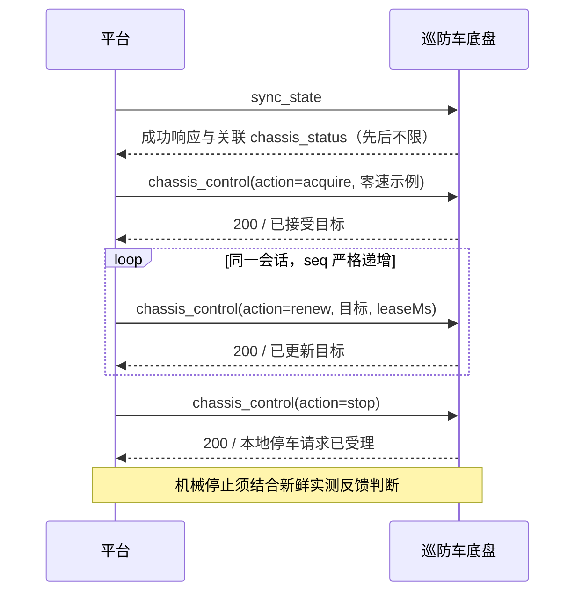

# A-BOX 巡防车底盘业务协议 V4.0

| 项目 | 内容 |
| --- | --- |
| 适用产品 | 巡防车底盘 |
| 文档修订号 | V4.0 |
| 报文版本 | `4.0` |
| Profile 名称及版本 | `vehicle_chassis 1.0` |
| 文档属性 | 业务接口规范 |
| 依赖协议 | [A-BOX 设备公共 MQTT 协议 V4.0](https://github.com/cxh0416/abox-platform-firmware/blob/main/docs/protocols/A-BOX设备公共MQTT协议-V4.0.md) |

## 目录

- [1. 范围与引用](#1-范围与引用)
- [2. 通信约定与能力声明](#2-通信约定与能力声明)
  - [2.1 Profile 声明](#21-profile-声明)
  - [2.2 接入流程](#22-接入流程)
- [3. 接口总览与时序约束](#3-接口总览与时序约束)
- [4. 命令定义](#4-命令定义)
  - [4.1 power_on](#41-power_on)
  - [4.2 power_off](#42-power_off)
  - [4.3 chassis_control](#43-chassis_control)
  - [4.4 sync_state](#44-sync_state)
- [5. 业务报告](#5-业务报告)
  - [5.1 chassis_status](#51-chassis_status)
  - [5.2 可选诊断扩展的线格式](#52-可选诊断扩展的线格式)
- [6. 交互与异常处理](#6-交互与异常处理)
  - [6.1 远控主时序](#61-远控主时序)
  - [6.2 持续安全规则](#62-持续安全规则)
- [7. 错误与产品约束](#7-错误与产品约束)
  - [7.1 业务失败语义](#71-业务失败语义)
  - [7.2 stopReason](#72-stopreason)

## 1. 范围与引用

本文定义巡防车底盘在 A-BOX MQTT V4 下的业务 Profile，包括车辆上下电、租约式底盘控制、完整底盘状态和业务安全语义。

公共通信及兼容规则遵循 [A-BOX 设备公共 MQTT 协议 V4.0](https://github.com/cxh0416/abox-platform-firmware/blob/main/docs/protocols/A-BOX设备公共MQTT协议-V4.0.md)；本文件补充底盘 Profile 与产品接口语义。

局部 JSON 示例按标题所示字段嵌入公共报文。

公共规则索引：[Topic / QoS / Retain](https://github.com/cxh0416/abox-platform-firmware/blob/main/docs/protocols/A-BOX设备公共MQTT协议-V4.0.md#21-topicqosretain)、[数值、未知字段及枚举](https://github.com/cxh0416/abox-platform-firmware/blob/main/docs/protocols/A-BOX设备公共MQTT协议-V4.0.md#32-数值扩展及非法报文)、[有效期与校验顺序](https://github.com/cxh0416/abox-platform-firmware/blob/main/docs/protocols/A-BOX设备公共MQTT协议-V4.0.md#43-有效期与校验顺序)、[幂等保护窗口](https://github.com/cxh0416/abox-platform-firmware/blob/main/docs/protocols/A-BOX设备公共MQTT协议-V4.0.md#44-请求一致性与保护窗口)、[公共响应码](https://github.com/cxh0416/abox-platform-firmware/blob/main/docs/protocols/A-BOX设备公共MQTT协议-V4.0.md#46-公共响应码与异常响应)、[状态同步](https://github.com/cxh0416/abox-platform-firmware/blob/main/docs/protocols/A-BOX设备公共MQTT协议-V4.0.md#6-完整状态与-sync_state)、[Profile 版本兼容](https://github.com/cxh0416/abox-platform-firmware/blob/main/docs/protocols/A-BOX设备公共MQTT协议-V4.0.md#74-profile-版本兼容)、[首次接入与 Manifest 主动获取](https://github.com/cxh0416/abox-platform-firmware/blob/main/docs/protocols/A-BOX设备公共MQTT协议-V4.0.md#75-平台首次接入与恢复流程)、[公共兼容性](https://github.com/cxh0416/abox-platform-firmware/blob/main/docs/protocols/A-BOX设备公共MQTT协议-V4.0.md#9-平台处理与-v4-兼容性)。

## 2. 通信约定与能力声明

### 2.1 Profile 声明

Profile 名称固定为 `vehicle_chassis`，为单实例能力，不使用 `instanceId`。

本 Profile 中 Number 类型的角度字段统一使用度（°），分辨率为 `0.001°`；数值编码、等价写法及请求摘要遵循公共 V4 第 3.2 节与附录 A。

Manifest Profile 条目固定为：

**示例 1：Manifest（设备 → 平台；`/zxwl/abox/demo_chassis_01/manifest`；profiles[] 局部片段）**

```json
{"name": "vehicle_chassis", "version": "1.0"}
```

同一固件固定提供该能力时可以省略 `manifestId`；其他 Manifest 规则遵循公共 V4。

### 2.2 接入流程

按公共[第 7.5 节](https://github.com/cxh0416/abox-platform-firmware/blob/main/docs/protocols/A-BOX设备公共MQTT协议-V4.0.md#75-平台首次接入与恢复流程)从 Manifest Topic 识别 `deviceId`，匹配平台支持主版本的 `vehicle_chassis`，并按公共第 7.3 节与当前心跳确认能力后使用命令。

完整状态及同步集合见[5.1](#51-chassis_status)、[4.4](#44-sync_state)。响应按 `deviceId` 和原 `requestId` 关联；控制会话按设备分别维护，`sessionId`、`seq`、`leaseMs` 不能由 `requestId` 替代。

## 3. 接口总览与时序约束

| 接口 / 匹配条件 | 分类 | `params` | `expiresAt` / 最大有效期 |
| --- | --- | --- | --- |
| `power_on` | `DISCRETE_ACTION` | `null` | 必填 / 5 秒 |
| `power_off` | `SAFETY_STOP` | `null` | 可选 |
| `chassis_control`, `action`=`acquire`/`renew` | `CONTINUOUS_SESSION` | 第 4.3 节 | 不使用 |
| `chassis_control`, `action`=`stop` | `SAFETY_STOP` | 第 4.3 节 | 不使用 |
| `chassis_status` | `state`，完整状态 | 第 5 节 `payload` | — |

## 4. 命令定义

有效期、可信时间、幂等和异常响应遵循公共 V4 第 4 节；本 Profile 的有效期限制见第 3 节。`sync_state` 和连续控制不使用 `expiresAt`。

### 4.1 `power_on`

分类、`params=null` 及有效期见[第 3 节](#3-接口总览与时序约束)。`200` 表示 MCU 电源输出命令已锁存，成功结果必含 `result.powerOutputOn`（Boolean，当前命令锁存状态）；不证明负载或整车实际已上电。运动目标仍受 MCU 实时安全条件约束，失败见[7.1](#71-业务失败语义)，完整状态见[5.1](#51-chassis_status)。

### 4.2 `power_off`

分类、`params=null` 及有效期见[第 3 节](#3-接口总览与时序约束)。`200` 表示 MCU 电源输出命令已关闭，当前运动目标和控制会话已撤销；成功结果必含 `result.powerOutputOn`（Boolean，当前命令锁存状态），不证明真实断电或车轮静止。安全停止允许重复执行；失败及完整状态分别见[7.1](#71-业务失败语义)、[5.1](#51-chassis_status)。

### 4.3 `chassis_control`

租约式底盘控制。

操作分类及有效期见[第 3 节](#3-接口总览与时序约束)。

| 字段路径 | 类型 | 必填或出现条件 | 约束与说明 |
| --- | --- | --- | --- |
| `params.action` | String | 是 | `acquire` / `renew` / `stop`；建立租约、更新目标并续租，或请求零速并释放会话。 |
| `params.sessionId` | String | 是 | 1～39 个字符；控制会话标识；不得用 `requestId` 替代。 |
| `params.seq` | Integer | 是 | `1..4294967295`；会话内序号；`acquire/renew` 必须严格递增；`stop` 不依赖序号递增。 |
| `params.leaseMs` | Integer | 是 | ms；`1..1000`；远控目标最长保持时间；到期未续租时撤销远控目标并停止行走。`stop` 也须携带。 |
| `params.driveRpm` | Integer | 是 | rpm；`-500..500`；行走目标；正负方向由产品标定定义，`0` 为零速。 |
| `params.steeringDeg` | Number | 是 | °；`-30.000..30.000`，精度 `0.001°`；轮胎转向角目标，`0` 为回中。 |

`code=200` 只表示请求通过会话和安全仲裁并更新设备目标，不表示车辆已运动、到位或停止。`data.result` 包含：

| 字段路径 | 类型 | 约束与说明 |
| --- | --- | --- |
| `result.targetDriveRpm` | Integer | 当前仲裁的行走目标，单位 rpm；`0` 不表示车轮已静止。 |
| `result.targetSteeringDeg` | Number | 当前仲裁的转向目标，单位 °；不是实测转角。 |
| `result.stopReason` | Integer | 当前或最近一次安全停止原因，见第 7.2 节。 |

非零 `driveRpm` 只有在兼容标定、有效控制会话及 MCU 当前运行安全条件满足时才接受；MCU 对目标是否继续执行作实时安全裁决。无需额外行走许可。

无有效远控目标时，设备可在本地安全条件满足且行走已确认停车后自行回中，适用于上电空闲及租约到期；不恢复会话，也不允许非零行走。新有效远控目标可接管转向。`stop` / `power_off` 取消回中并保持安全停车；新有效目标或显式上电可重新允许空闲回中。目标 `0` 不证明已回中，以两路实测转角判断。

格式有效的 `stop` 先将本地目标归零并请求安全停车，不因 `sessionId` 不匹配或 `seq` 未递增而保留非零目标。会话匹配则释放，不匹配保留原归属，不让请求方抢占控制权。重复 `stop` 安全且幂等；`code=200` 仅表示本地停车请求受理，不证明车轮静止。

持续安全规则见[第 6 节](#6-交互与异常处理)，失败语义见[第 7 节](#7-错误与产品约束)。

以下为零速会话目标请求及响应：

**示例 2：`chassis_control`（平台 → 设备；`/zxwl/abox/demo_chassis_01/request`；完整请求）**

```json
{"version": "4.0", "timestamp": 1800000000000, "data": {"requestId": "patrol-control-001", "command": "chassis_control", "params": {"action": "acquire", "sessionId": "patrol-session-001", "seq": 1, "leaseMs": 1000, "driveRpm": 0, "steeringDeg": 0}}}
```

**示例 3：`chassis_control`（设备 → 平台；`/zxwl/abox/demo_chassis_01/response`；data 局部片段）**

```json
{"requestId": "patrol-control-001", "code": 200, "msg": "operation accepted", "result": {"targetDriveRpm": 0, "targetSteeringDeg": 0, "stopReason": 0}}
```

关联报告：当前目标与实测反馈见[第 5.1 节 `chassis_status`](#51-chassis_status)。

### 4.4 `sync_state`

`sync_state` 的通用规则由公共 V4 定义。本 Profile 的预期完整状态集合为：

**示例 4：`sync_state`（设备 → 平台；`/zxwl/abox/demo_chassis_01/response`；result 局部片段）**

```json
{"expectedStates": [{"reportName": "chassis_status"}]}
```

设备随后发布完整 `chassis_status`，并按公共规则关联同一 `requestId`。

## 5. 业务报告

### 5.1 `chassis_status`

单实例完整 `state`；Topic、QoS 及启动、重连、同步触发遵循公共协议第 2、5、6 节。

| 字段路径 | 类型 | 约束与说明 |
| --- | --- | --- |
| `payload.reportReason` | String | `periodic`、`reconnect`、`state_changed`、`fault_raised`、`fault_cleared` 或 `safety_stop`。 |
| `payload.motionState` | String | `fault`、`reversing_wait`、`driving` 或 `stopped`。反馈过期时 `stopped` 不证明车轮静止。 |
| `payload.targetDriveRpm` | Integer | 当前行走目标，单位 rpm；不是实测值。 |
| `payload.targetSteeringDeg` | Number | 当前转向目标，单位 °；不是实测值。 |
| `payload.leftActualRpm`、`payload.rightActualRpm` | Integer | 分别为左、右驱动最近实测转速，rpm，须结合 `feedbackFresh`。 |
| `payload.steeringActualDeg` | Number | 转向驱动器最近反馈角度，单位 °，须结合 `feedbackFresh`。 |
| `payload.absoluteActualDeg` | Number | 独立编码器最近反馈角度，单位 °，须结合 `encoderOnline` 和 `feedbackFresh`。 |
| `payload.steeringOnline`、`payload.driveOnline`、`payload.encoderOnline` | Boolean | 分别为转向、行走、独立编码器节点或对应反馈是否在线有效。 |
| `payload.canBusOff` | Boolean | CAN 是否 Bus-Off；为 `true` 时禁止运动。 |
| `payload.driveFault` | Boolean | 驱动器是否报告故障；为 `true` 时禁止运动。 |
| `payload.feedbackFresh` | Boolean | 运动反馈是否仍在有效时限内；心跳不能刷新该状态。 |
| `payload.calibrated` | Boolean | 是否具备兼容的转向标定。 |
| `payload.steeringProfileReady` | Boolean | 转向安全配置是否满足运行要求。 |
| `payload.steeringRangeValid` | Boolean | 独立转角反馈是否位于允许运行范围。 |
| `payload.powerReady` | Boolean | 是否满足接受运动目标的电源条件；不是外部供电反馈。 |
| `payload.powerOutputOn` | Boolean | MCU 电源输出命令锁存状态；不是触点或负载反馈。 |
| `payload.otaBusy` | Boolean | OTA 是否处于禁止运动阶段。 |
| `payload.safetyReady` | Boolean | 设备当前计算的运动就绪观测值；不表示车辆已运动或环境安全。 |
| `payload.stopReason` | Integer | 安全停止原因，见第 7.2 节。 |
| `payload.faultLatched` | Boolean | 是否存在必须明确复位的锁存故障。 |
| `payload.steeringBoundary` | Integer | `-1` 负向、`0` 无、`1` 正向边界；非零时禁止行走，只允许转向回退。 |
| `payload.faultRecordVersion` | Integer | 故障记录结构版本，当前为 `1`。 |
| `payload.lastFault` | Array&lt;Integer&gt; | 可选的版本化历史故障记录；与 `transportDiagnostics` 至多出现一个。元素定义见[第 5.2 节](#52-可选诊断扩展的线格式)。 |
| `payload.transportDiagnostics` | Object | 可选通信诊断计数，仅用于观测，不参与运动许可；与 `lastFault` 至多出现一个。子字段定义见[第 5.2 节](#52-可选诊断扩展的线格式)。 |

`payload` 及整包分别受公共 768 / 1024 字节上限限制，整包计入 `reportId`、`requestId` 和全部已携带流字段。超预算时省略可选诊断，必填状态保持完整；公共状态不保证完整传输历史故障记录。

本 Profile 普通完整状态遵循公共第 5.3 节的接收顺序与去重规则；时间戳、目标值、节点在线或公共心跳均不能替代新鲜的实测反馈。

`safetyReady` 及组成字段用于状态展示、诊断和操作提示，不增设平台侧 `acquire/renew` 授权门禁。平台可提示未就绪，不得复制 MCU 条件组合决定是否发请求；以设备实时响应和持续安全裁决为准。

### 5.2 可选诊断扩展的线格式

诊断字段省略不表示无故障或通信正常，不发送 `null`；未知 `faultRecordVersion` 记录可原样保存，不按版本 1 的位置解释。诊断值不作为当前控制授权或动作完成证据。

`faultRecordVersion=1` 时，`payload.lastFault` 固定包含 29 个 Integer。索引从 0 开始；索引 5～9 为有符号 32 位整数，其余为无符号 32 位整数。未特别注明的原始诊断码没有公共业务枚举，接收方可原样展示或忽略。

| 索引 | 内容 | 单位及取值语义 |
| --- | --- | --- |
| `0` | 记录序号 | 无量纲；`0..4294967295` |
| `1` | 记录发生时的设备运行时间 | ms；非 UTC，可回绕 |
| `2` | 记录来源码 | 无量纲；`1` 运动保护、`2` 中位标定；未知值保留 |
| `3` | 原因码 | 原始诊断码；不保证与当前 `stopReason` 共用枚举 |
| `4` | 当时运行条件诊断值 | 原始诊断值；不用于推导当前许可 |
| `5` | 当时行走目标 | rpm；有符号 |
| `6` | 当时转向目标 | `0.001°`；有符号 |
| `7`、`8` | 两路行走实测转速 | rpm；有符号；历史值不表示当前反馈新鲜 |
| `9` | 转向反馈原始位置 | 原始计数；有符号，不直接解释为度 |
| `10` | 独立编码器原始位置 | 原始计数，不直接解释为度 |
| `11`、`12` | 转向、行走状态原值 | 原始状态码，不作为当前在线或成功证据 |
| `13`、`14` | 两路行走故障码原值 | 原始故障码；结合索引 15、16 的采样年龄 |
| `15`、`16`、`17`、`18` | 两路故障码、转向状态、行走状态的采样年龄 | ms；`4294967295` 表示无有效采样年龄，零码不能据此解释为无故障 |
| `19`、`20`、`21` | 转向诊断阶段、步骤、执行错误原值 | 无量纲原始诊断值 |
| `22`、`23`、`24` | 行走诊断阶段、步骤、执行错误原值 | 无量纲原始诊断值 |
| `25` | 下游通信异常原值 | 无量纲原始诊断码 |
| `26` | 编码器异常原值 | 无量纲原始诊断码 |
| `27` | 标定阶段原值 | 无量纲原始诊断值 |
| `28` | 本机记录保存状态 | `0` 待保存、`1` 已保存、`2` 保存失败或空间已满 |

`payload.transportDiagnostics` 出现时须含下表全部 Integer 字段，范围均为 `0..4294967295`，不使用 `null`。计数限本次运行，可回绕或重启清零；不得跨设备/重启直接累加，单个零计数不证明链路正常。

| 字段路径 | 单位 | 含义 |
| --- | --- | --- |
| `payload.transportDiagnostics.mqttRxLines` | 次 | 收到的 MQTT 接收通知行数 |
| `payload.transportDiagnostics.mqttRxDecoded` | 次 | 成功解码的消息数 |
| `payload.transportDiagnostics.mqttRxRejected` | 次 | 拒绝的接收帧数 |
| `payload.transportDiagnostics.mqttRxDispatched` | 次 | 已分发的消息数 |
| `payload.transportDiagnostics.mqttRxOverwrites` | 次 | 待处理消息被覆盖次数 |
| `payload.transportDiagnostics.mqttRxTimeouts` | 次 | 多行接收超时次数 |
| `payload.transportDiagnostics.mqttRxLastMs` | ms | 最近一次接收通知的设备运行时间；非 UTC，可回绕 |
| `payload.transportDiagnostics.ecDmaOverflows` | 次 | 接收缓冲溢出计数 |
| `payload.transportDiagnostics.ecDmaRestarts` | 次 | 接收通道重启计数 |
| `payload.transportDiagnostics.ecDmaMaxBacklog` | Byte | 接收缓冲积压量的运行期最大观测值 |
| `payload.transportDiagnostics.ecLineOverflows` | 次 | 接收行缓冲溢出计数 |

## 6. 交互与异常处理

### 6.1 远控主时序

下图沿用[第 4.3 节](#43-chassis_control)的零速申请示例；请求参数、成功边界和持续安全约束仍按对应条款判断。



### 6.2 持续安全规则

- 未标定、反馈过期、双转角偏差超限、节点离线、CAN Bus-Off、驱动故障、OTA 忙、转向配置无效或其他 MCU 当前安全条件不满足时拒绝控制目标，并在持续执行中请求安全停止；
- 改变前进/后退方向前先发送零速，并连续三次确认左右实测转速绝对值不超过 `20 rpm`；2 秒超时撤销会话并锁存故障；
- 租约超时、连接中断或安全条件失效时进入安全停止；

机械停止的判定见[4.3](#43-chassis_control)及主时序图。

## 7. 错误与产品约束

### 7.1 业务失败语义

公共错误码遵循公共 V4。电源不可用或写入失败不得报成功；目标越界、安全不满足、`acquire/renew` 会话不匹配或流程忙时，不得更新为非零目标或抢占有效会话；内部异常不得用成功响应掩盖。

### 7.2 `stopReason`

| 值 | 名称 | 含义 |
| ---: | --- | --- |
| `0` | `none` | 无停止原因。 |
| `1` | `reserved` | 保留值，正式运行不产生；后续编号保持不变。 |
| `2` | `uncalibrated` | 无可用转向标定。 |
| `3` | `feedback_stale` | 运动反馈过期。 |
| `4` | `angle_mismatch` | 双转角反馈偏差超限。 |
| `5` | `node_offline` | 必需节点离线。 |
| `6` | `can_bus_off` | CAN Bus-Off。 |
| `7` | `drive_fault` | 驱动器故障。 |
| `8` | `ota_busy` | OTA 忙。 |
| `9` | `power_not_ready` | 电源条件不满足。 |
| `10` | `lease_expired` | 控制租约到期。 |
| `11` | `direction_timeout` | 换向静止确认超时并锁存故障。 |
| `12` | `explicit_stop` | 明确停止。 |
| `13` | `execution_fault` | 执行故障已锁存。 |
| `14` | `encoder_range` | 独立转角超出运行范围。 |
| `15` | `encoder_profile` | 转向安全配置不满足要求。 |
